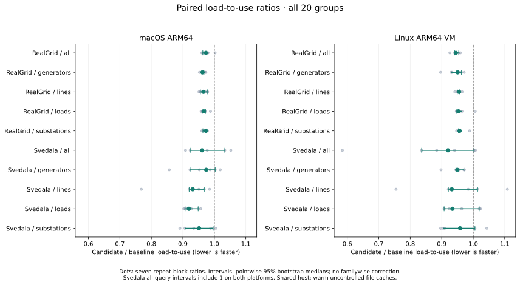
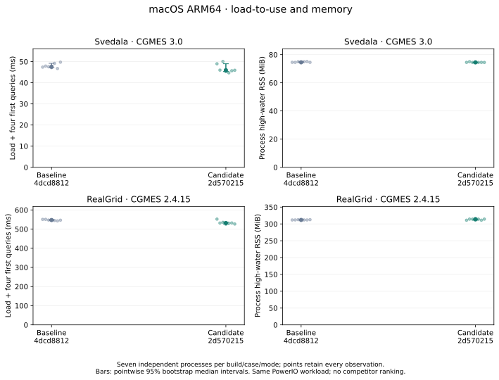
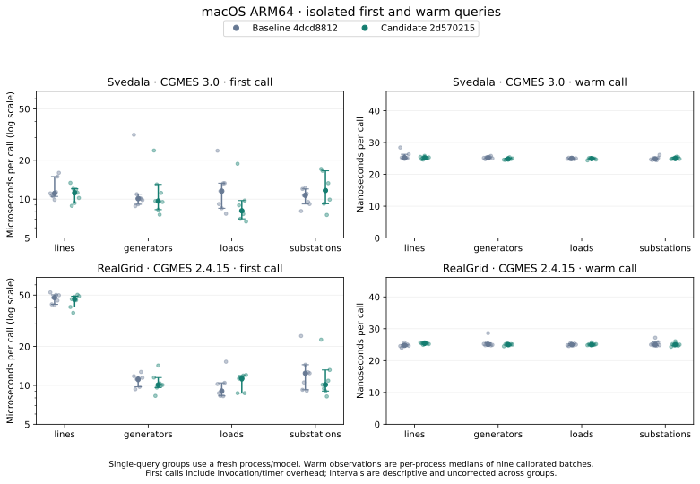
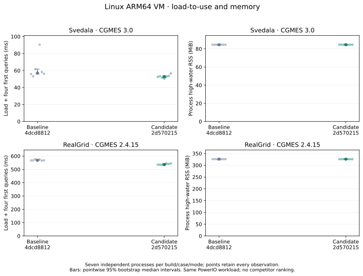
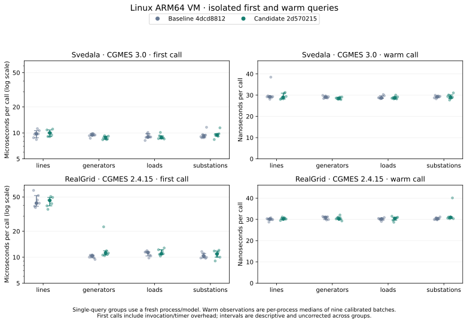

# CGMES namespace-cache experiment

All 280 predeclared serial fresh-process runs succeeded: seven independent repeats × two builds × two platforms × two cases × five query selections. This compares PowerIO before and after one internal cache change; it is not a competitor ranking.

Baseline: `4dcd881266b943f4405351e9e4f2aef30039a8b1`. Candidate: `2d570215aea1b0dc7d0257e0b0909753869253fb`. Harness: `ea5444916ef4d038ebf514b4617ec078f83914da`.

Both builds use release mode, locked dependencies, default features plus `gridfm`, and maturin 1.16.0. Native builds use Rust 1.98.1/Python 3.13.18; Linux builds use the same pinned Rust 1.99.0 builder image and Python 3.14 runtime. Platforms are analyzed separately. The 18-core Apple M5 Pro/64 GiB desktop and its 8-CPU/16 GiB Linux VM are shared environments, without affinity or file-cache flushing. Per-run ambient observations are retained.

Seven independently launched process pairs per platform/case/query, blocked randomized order; per-process warm batch medians. 10,000 percentile bootstrap resamples of independent pairs; same fixed resampling seed for reproducibility.

The paired median RealGrid all-query load-to-use ratio is 0.9732 [0.9633, 0.9800] on macOS and 0.9450 [0.9408, 0.9541] on Linux. Svedala all-query ratios are 0.9611 [0.9233, 1.0333] and 0.9200 [0.8362, 1.0023]; these intervals do not establish a Svedala improvement. These are descriptive pointwise intervals from seven pairs, not guarantees or multiple-comparison-adjusted claims.

| Platform | Case | Query selection | Candidate / baseline load-to-use [95% interval] | Baseline → candidate, ms | Peak RSS, MiB |
|---|---|---|---:|---:|---:|
| Linux ARM64 VM | RealGrid · CGMES 2.4.15 | all | 0.9450 [0.9408, 0.9541] | 568.296 → 535.939 | 325.92 → 325.93 |
| Linux ARM64 VM | RealGrid · CGMES 2.4.15 | generators | 0.9504 [0.9297, 0.9627] | 579.060 → 548.768 | 325.99 → 325.92 |
| Linux ARM64 VM | RealGrid · CGMES 2.4.15 | lines | 0.9552 [0.9493, 0.9561] | 565.999 → 539.825 | 325.94 → 325.82 |
| Linux ARM64 VM | RealGrid · CGMES 2.4.15 | loads | 0.9534 [0.9478, 0.9643] | 569.115 → 540.428 | 325.94 → 325.78 |
| Linux ARM64 VM | RealGrid · CGMES 2.4.15 | substations | 0.9568 [0.9529, 0.9586] | 567.441 → 542.917 | 325.96 → 325.97 |
| Linux ARM64 VM | Svedala · CGMES 3.0 | all | 0.9200 [0.8362, 1.0023] | 57.069 → 52.878 | 84.55 → 84.56 |
| Linux ARM64 VM | Svedala · CGMES 3.0 | generators | 0.9493 [0.9450, 0.9703] | 55.402 → 52.901 | 84.61 → 84.61 |
| Linux ARM64 VM | Svedala · CGMES 3.0 | lines | 0.9320 [0.9211, 1.0139] | 55.662 → 53.083 | 84.46 → 84.46 |
| Linux ARM64 VM | Svedala · CGMES 3.0 | loads | 0.9341 [0.9076, 1.0190] | 56.249 → 53.058 | 84.45 → 84.46 |
| Linux ARM64 VM | Svedala · CGMES 3.0 | substations | 0.9585 [0.9045, 1.0055] | 56.442 → 51.803 | 84.61 → 84.61 |
| macOS ARM64 | RealGrid · CGMES 2.4.15 | all | 0.9732 [0.9633, 0.9800] | 547.318 → 531.631 | 311.83 → 314.16 |
| macOS ARM64 | RealGrid · CGMES 2.4.15 | generators | 0.9624 [0.9605, 0.9699] | 547.757 → 530.246 | 311.69 → 312.56 |
| macOS ARM64 | RealGrid · CGMES 2.4.15 | lines | 0.9655 [0.9557, 0.9775] | 548.911 → 530.570 | 311.77 → 311.25 |
| macOS ARM64 | RealGrid · CGMES 2.4.15 | loads | 0.9662 [0.9616, 0.9721] | 549.107 → 530.272 | 311.66 → 311.23 |
| macOS ARM64 | RealGrid · CGMES 2.4.15 | substations | 0.9732 [0.9637, 0.9760] | 547.819 → 532.828 | 311.69 → 314.09 |
| macOS ARM64 | Svedala · CGMES 3.0 | all | 0.9611 [0.9233, 1.0333] | 47.577 → 45.937 | 74.56 → 74.53 |
| macOS ARM64 | Svedala · CGMES 3.0 | generators | 0.9742 [0.9229, 1.0028] | 48.610 → 46.567 | 74.44 → 74.50 |
| macOS ARM64 | Svedala · CGMES 3.0 | lines | 0.9314 [0.9200, 0.9680] | 48.840 → 45.688 | 74.44 → 74.53 |
| macOS ARM64 | Svedala · CGMES 3.0 | loads | 0.9191 [0.9072, 0.9487] | 48.285 → 45.776 | 74.50 → 74.50 |
| macOS ARM64 | Svedala · CGMES 3.0 | substations | 0.9514 [0.9067, 0.9962] | 48.315 → 46.410 | 74.89 → 74.55 |

## Query costs and memory

The optimization caches at most 512 bytes of a recognized CIM namespace per document during parsing. Query code is unchanged, but measured query latency is not uniformly lower. The Linux RealGrid isolated first generator query has a paired ratio of 1.0975 [1.0583, 1.1857]; several warm-query groups also have pointwise intervals above 1. All such observations remain in the comparison JSON and figures. These small, uncorrected comparisons do not by themselves identify a causal query-code regression.

Native RealGrid all-query median peak RSS rises from 311.83 to 314.16 MiB in this cohort; the paired interval includes 1. RSS includes interpreter/import and allocator effects and is not a measurement of the cache allocation itself. No uniform memory reduction is claimed.

## Correctness qualification

- All four required local gates pass at candidate 2d570215: formatting, workspace tests, C ABI tests and all seven Clippy configurations. All 131 focused CGMES regressions pass, including namespace rebinding and bounded-cache cases.
- Both measured cases have byte-identical complete IR, retained replay, fresh CGMES output, IR-restored fresh output and ordered diagnostics across the two wheels. Raw network outputs are retained locally; hashes and reproduction scripts are included.
- Native PowSyBl 1.16.1 passes 24 synthetic transformer/tap cases for each wheel, both before and after PowerIO CGMES re-import. It checks physical impedance, rated voltages and every phase-tap step and detects altered negative controls. This does not test power-flow solves or comprehensive CGMES conformance.
- Two harness setup errors are preserved: the first fidelity capture lacked the RealGrid input link; the first native-oracle negative control attempted to mutate linear tap fields after canonical re-emission had correctly made them tabular. The corrected v2 oracle changes the relevant fields explicitly and requires at least one mutation. No library failure was suppressed.

## Limits

- Pointwise descriptive bootstrap intervals with only seven independent pairs; no familywise or selection correction.
- Two CGMES cases and count queries only. No export timing, other formats, or competitor ranking.
- Shared desktop activity and warm uncontrolled filesystem caches; no CPU affinity. Native and VM results are separate groups.
- RSS includes interpreter/imports and excludes children. It does not measure allocation volume or transient object lifetimes.
- All query mode measures the ordered sequence; single-query groups isolate the first use of that query.
- Equal counts are supplemented by complete before/after IR/replay/fresh-output/diagnostic comparison; that comparison is not an independent format oracle.
- Commit 2d570215 is a candidate branch; future RC integration needs final-commit qualification.

## Evidence and reproduction

- [Comparison JSON](comparison.json) retains every reduced process sample, first/warm metric, memory phase, paired ratio and input fingerprint.
- [Plan](raw/plan.json), raw invocation/results, [build receipts](builds/), [qualification receipts](qualification/) and [manifest](manifest.json) pin sources, compilers, options, wheels, container images and inputs. Logs are losslessly compressed.
- [Reproduction scripts](reproduce/) preserve the host commands; configure equivalent local paths and obtain the pinned source/data commits. No dataset or wheel binaries are vendored.
- Regenerate this report with `python tools/generate_namespace_report.py results-native-lifecycle/2026-11-10-cgmes-namespace-cache` using `matplotlib==3.10.8`.
