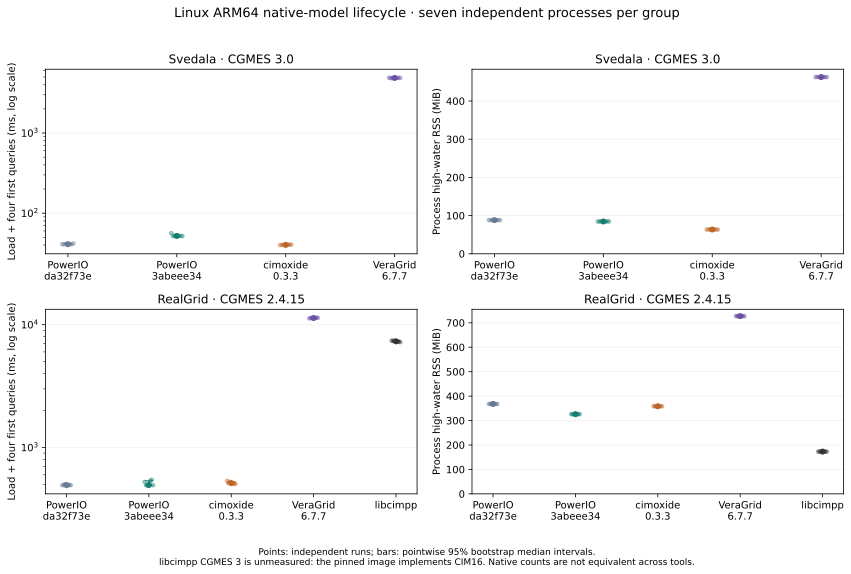
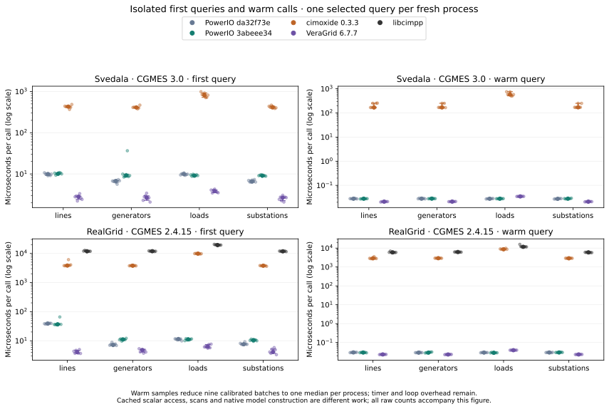

# Linux ARM64 native lifecycle comparison

This cohort contains all 315 planned independent processes: seven repeats, five query modes, two datasets for four participants, and RealGrid for the CIM16 libcimpp image. All invocations succeeded. The interrupted earlier harness attempt is retained separately and is not a tool failure or part of these timings.

Harness: `ea5444916ef4d038ebf514b4617ec078f83914da`. PowerIO sources: stable `da32f73ea3d9beb283b7d84530985e44eba90741` and historical RC `3abeee34e3c8fc0dc913526d40da27db37041ee6`.

The RC head changed to `4dcd881266b943f4405351e9e4f2aef30039a8b1` during measurement. This cohort does not qualify that newer head.

PowerIO builds use the same immutable builder, release mode, locked dependencies, default features plus `gridfm`, and Rust 1.99.0. All runtime images use Python 3.14.6. Every participant uses a pinned image in the same Linux ARM64 Podman VM, with eight CPUs and 16,714,772,480 bytes of RAM. Each run uses a new container, no network, and the same read-only inputs. Filesystem caches are uncontrolled; no CPU affinity is set. The comparison does not establish matched compiler optimizations across different competitors.

Seven independently launched processes per participant/case/query mode; blocked randomized order with fixed seed202611101. Warm medians are reduced per process before uncertainty estimation.10,000 percentile bootstrap resamples across processes; paired ratios use the repeat block.

The historical RC regresses on Svedala. RealGrid does not establish an improvement over stable. Ratios below are paired within repeat blocks; values above one are slower.

| Case | Query mode | RC / stable load-to-use | Pointwise 95% interval |
|---|---|---:|---:|
| RealGrid · CGMES 2.4.15 | all | 1.0017 | [0.9976, 1.0855] |
| RealGrid · CGMES 2.4.15 | generators | 0.9919 | [0.9780, 0.9995] |
| RealGrid · CGMES 2.4.15 | lines | 0.9926 | [0.9883, 1.0067] |
| RealGrid · CGMES 2.4.15 | loads | 0.9933 | [0.9895, 1.0018] |
| RealGrid · CGMES 2.4.15 | substations | 1.0012 | [0.9816, 1.0267] |
| Svedala · CGMES 3.0 | all | 1.2665 | [1.2533, 1.2781] |
| Svedala · CGMES 3.0 | generators | 1.2903 | [1.2659, 1.2930] |
| Svedala · CGMES 3.0 | lines | 1.2566 | [1.2298, 1.2944] |
| Svedala · CGMES 3.0 | loads | 1.2717 | [1.1814, 1.2875] |
| Svedala · CGMES 3.0 | substations | 1.2557 | [1.2460, 1.2875] |

Each single-query mode measures its first call on a freshly loaded model. Earlier calls may initialize later queries in `all` mode. Load-to-use sums load and the selected first calls; import-to-use also includes adapter import/construction. Neither includes instrumentation between stages or container/process startup.

## Counts and applicability

| Case | Participant | Lines | Generators | Loads | Substations |
|---|---|---:|---:|---:|---:|
| Svedala · CGMES 3.0 | PowerIO da32f73e | 97 | 39 | 80 | 57 |
| Svedala · CGMES 3.0 | PowerIO 3abeee34 | 97 | 39 | 80 | 57 |
| Svedala · CGMES 3.0 | cimoxide 0.3.3 | 97 | 39 | 73 | 57 |
| Svedala · CGMES 3.0 | VeraGrid 6.7.7 | 97 | 39 | 73 | 56 |
| Svedala · CGMES 3.0 | libcimpp | unmeasured | unmeasured | unmeasured | unmeasured |
| RealGrid · CGMES 2.4.15 | PowerIO da32f73e | 7561 | 1347 | 6687 | 4875 |
| RealGrid · CGMES 2.4.15 | PowerIO 3abeee34 | 7561 | 1347 | 6687 | 4875 |
| RealGrid · CGMES 2.4.15 | cimoxide 0.3.3 | 7561 | 1347 | 6687 | 4875 |
| RealGrid · CGMES 2.4.15 | VeraGrid 6.7.7 | 7561 | 1347 | 6687 | 4875 |
| RealGrid · CGMES 2.4.15 | libcimpp | 7561 | 1347 | 6687 | 4875 |

PowerIO includes equivalent injections in its load table. Svedala counts disagree across participants; matching RealGrid counts alone does not prove equivalent fields or work. These observations do not prove a cross-tool ranking or universal first place.

libcimpp on Svedala is a coverage gap in this pinned CIM16 build, not evidence that every libcimpp configuration lacks CGMES 3 support. PyPowSyBl was measured in the separate native macOS cohort; its pinned Linux ARM64 wheel is unavailable. RDF/triplestore, CLI, fresh-export and other platform groups are outside this cohort.

## Provenance and limitations

Image IDs and installed package inventories are recorded for every participant. The libcimpp adapter reports `2.2.0` as a literal; that string alone does not independently verify its upstream source revision. Competitor source-build reproducibility remains incomplete even though the exact executable images are pinned. Missing Git inside libcimpp is recorded as a provenance-observation error after timing and does not discard its measurements.

- Small n; pointwise bootstrap intervals are descriptive and do not control familywise error across all groups.
- Shared Linux ARM64 VM on macOS;8vCPUs and16GiB memory; no CPU affinity, uncontrolled filesystem caches. Import excluded from load; reported separately.
- Native models and count semantics differ across participants; no cross-tool win is inferred without semantic equivalence.
- This covers a Linux ARM64 native-model library cohort, not fresh export, RDF/triplestore/CLI families or all registered competitors. libcimpp CGMES3 is unsupported by the pinned image; PyPowSyBl has no pinned Linux ARM64 wheel.
- Candidate3abeee34 was superseded by4dcd8812 while measuring; these historical measurements cannot qualify the final RC head.
- Process RSS includes interpreter/imports and excludes children; it is not model allocation volume.

## Raw results and reproduction

- [Comparison JSON](comparison.json) preserves all process samples and descriptive uncertainty.
- [Plan](raw/plan.json) records image identities, source commits, random seed, exclusions, timeout and order. `raw/*-packages.json` records installed package versions.
- `raw/` contains each result, invocation receipt and losslessly compressed stdout/stderr log. [The manifest](manifest.json) hashes every artifact; `.log.gz` files decompress to the original log bytes.
- [Reproduction scripts](reproduce/) preserve the original runner and reducer. Configure local paths and obtain the exact input and image identities before repeating; cached image identities are not a portable source-build recipe.
- Regenerate figures with `python tools/generate_linux_lifecycle_report.py results-native-lifecycle/2026-11-10-linux-arm64` using `matplotlib==3.10.8`.

The earlier interrupted attempt is retained in `superseded-attempt/`; it demonstrates the harness failure and is excluded by provenance, never by measured speed.
