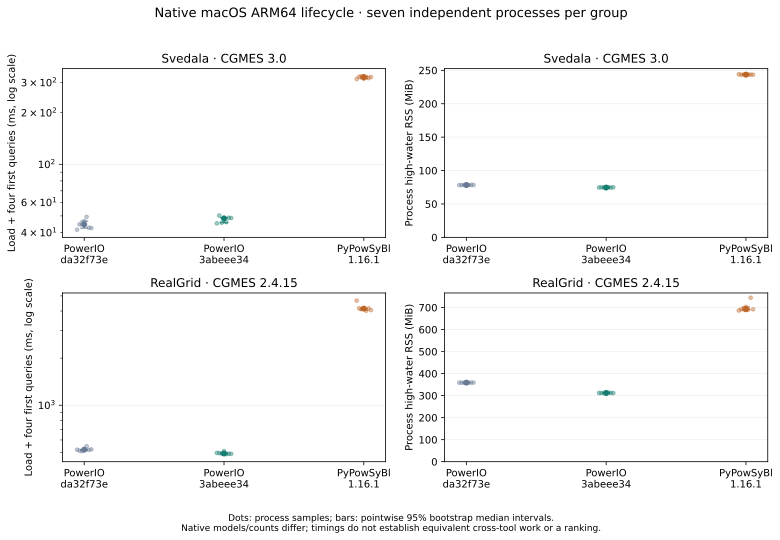
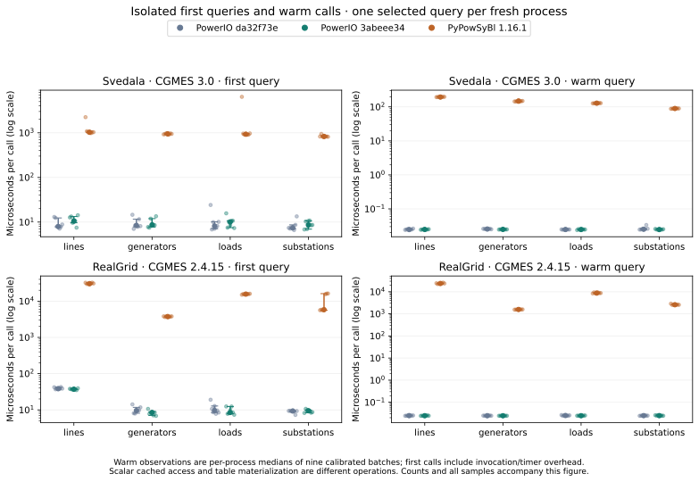

# Native lifecycle comparison

This cohort records 210 fresh processes on macOS ARM64: seven repeats × two datasets × five query modes × three participants. It supplements the calibrated pytest benchmark; it does not establish universal first place.

Harness: `c00f8fe24ec2c27a3be8e63d5bccca7184b5e551`. PowerIO sources: stable `da32f73ea3d9beb283b7d84530985e44eba90741` and RC `3abeee34e3c8fc0dc913526d40da27db37041ee6`. PyPowSyBl: `1.16.1`.

Matched PowerIO builds use release mode, the locked dependencies, default features plus `gridfm`, Rust 1.98.1, maturin 1.16.0 and Python 3.13.18. The shared host is an Apple M5 Pro with 18 CPU cores and 64 GiB RAM; caches were uncontrolled and no affinity was set.

Seven independently launched processes per participant/case/query mode; blocked randomized order with fixed seed20261110. Warm medians are reduced per process before uncertainty estimation.10,000 percentile bootstrap resamples across processes; paired ratios use the repeat block.

The RC is slower on Svedala and faster on RealGrid in this experiment. The following ratios pair each RC sample with its stable sample in the same repeat block; ratios above one are slower.

| Case | Mode | RC / stable load-to-use | Pointwise 95% interval |
|---|---|---:|---:|
| RealGrid · CGMES 2.4.15 | all | 0.9544 | [0.9369, 0.9665] |
| RealGrid · CGMES 2.4.15 | generators | 0.9450 | [0.9317, 0.9575] |
| RealGrid · CGMES 2.4.15 | lines | 0.9392 | [0.8982, 0.9586] |
| RealGrid · CGMES 2.4.15 | loads | 0.9522 | [0.9477, 0.9578] |
| RealGrid · CGMES 2.4.15 | substations | 0.9521 | [0.9419, 0.9665] |
| Svedala · CGMES 3.0 | all | 1.0889 | [1.0226, 1.1427] |
| Svedala · CGMES 3.0 | generators | 1.0397 | [1.0218, 1.0904] |
| Svedala · CGMES 3.0 | lines | 1.1358 | [1.0699, 1.1687] |
| Svedala · CGMES 3.0 | loads | 1.1044 | [1.0642, 1.1195] |
| Svedala · CGMES 3.0 | substations | 1.0361 | [1.0109, 1.0958] |

Each single-query mode measures its first call on a newly loaded model. In `all` mode, earlier queries may initialize later ones. Load-to-use sums the load and first calls, excluding measurement instrumentation between stages. Import-to-use adds import/adapter construction; it is not end-to-end process wall time.

## Native counts and comparability

| Case | Participant | Lines | Generators | Loads | Substations |
|---|---|---:|---:|---:|---:|
| Svedala · CGMES 3.0 | PowerIO da32f73e | 97 | 39 | 80 | 57 |
| Svedala · CGMES 3.0 | PowerIO 3abeee34 | 97 | 39 | 80 | 57 |
| Svedala · CGMES 3.0 | PyPowSyBl 1.16.1 | 90 | 39 | 73 | 57 |
| RealGrid · CGMES 2.4.15 | PowerIO da32f73e | 7561 | 1347 | 6687 | 4875 |
| RealGrid · CGMES 2.4.15 | PowerIO 3abeee34 | 7561 | 1347 | 6687 | 4875 |
| RealGrid · CGMES 2.4.15 | PyPowSyBl 1.16.1 | 7561 | 1347 | 6687 | 4791 |

PowerIO includes equivalent injections in load counts and retains source/boundary substations. PyPowSyBl converts equipment into its native network and materializes queried tables. The count mismatches require a field-level audit; equal counts alone would not prove equivalent work.

## Limits

- Small n; pointwise bootstrap intervals are descriptive and do not control familywise error across all groups.
- Shared macOS host, no CPU affinity, uncontrolled filesystem caches. Import excluded from load; reported separately.
- PyPowSyBl queries materialize tables and native count semantics can differ; no cross-tool win is inferred.
- This covers native macOS ARM64 library lifecycle only, not fresh export, Linux or all registered competitors.
- Candidate3abeee34 is the observed current head; later RC integration requires fresh final-head measurements.
- Process RSS includes interpreter/imports and excludes children; it is not model allocation volume.

## Raw evidence and reproduction

- [Comparison JSON](comparison.json) includes every mode, raw process-level samples and uncertainty.
- [Raw plan](raw/plan.json), [installed packages](raw/packages.txt), and [SHA-256 manifest](manifest.json) retain inputs, compiler/build identities, wheel hashes, invocation order, environment observations and every result.
- [Reproduction scripts](reproduce/) retain the original build, run and reduction commands. Their paths describe the recorded host; configure equivalent local paths and the pinned dataset checkouts when repeating.
- Regenerate figures and Markdown with `python tools/generate_lifecycle_report.py results-native-lifecycle/2026-11-10-macos-arm64` using `matplotlib==3.10.8`.

Recorded failures: 0. No measurements were omitted based on speed. Linux, export and remaining competitors still require matched repeated measurements.
