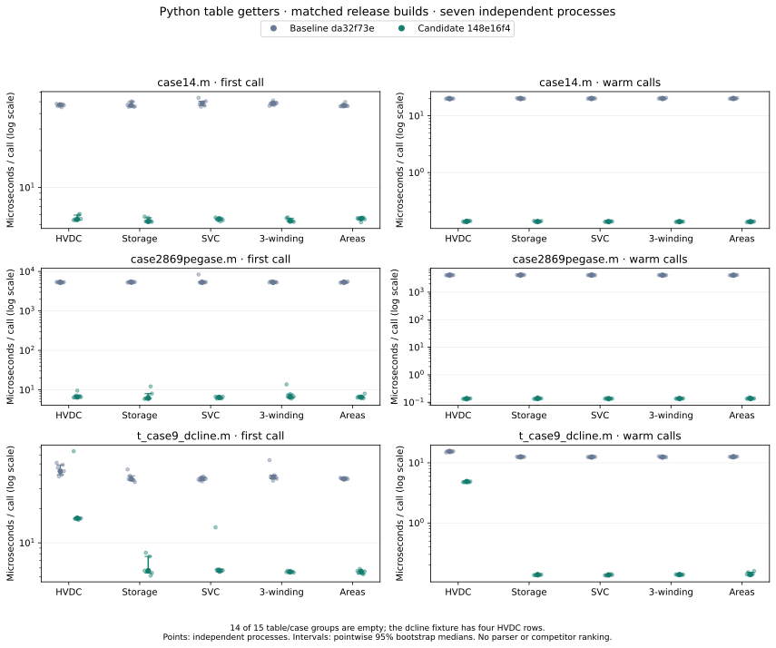

# Python table-access experiment

This is a narrow accessor experiment: 14 of the 15 table/case groups return empty tables, and one returns four HVDC rows. It tests removal of unrelated whole-network serialization. It does not benchmark distribution table performance or establish a parser/competitor ranking. All 210 planned fresh-process invocations succeeded; every group returned byte-equivalent canonical JSON across both versions.

PowerIO commits: baseline `da32f73ea3d9beb283b7d84530985e44eba90741`, candidate `148e16f489c54c8921d131e06127547b9ef6d0df`. Both release wheels use Rust 1.98.1, maturin 1.16.0, locked dependencies, default features plus `gridfm`, and native macOS ARM64 with Python 3.13.18. Build records and full source-file hashes are in `raw/plan.json`.

Seven randomized blocks, one fresh process per version/case/table in each block; nine warm batches reduce to one median per process; 10,000 bootstrap resamples; paired candidate/stable ratios within blocks.

| Case | Table (rows) | First call, µs: baseline → candidate | Warm, µs: baseline → candidate | Load-to-use candidate / baseline [95% interval] | Peak RSS MiB: baseline → candidate |
|---|---|---:|---:|---:|---:|
| case14.m | areas (0) | 46.458 → 5.583 | 20.169 → 0.136 | 0.8540 [0.8088, 0.8687] | 32.17 → 32.06 |
| case14.m | hvdc (0) | 47.125 → 5.500 | 20.016 → 0.138 | 0.8491 [0.8175, 0.8517] | 32.17 → 32.06 |
| case14.m | static_var_compensators (0) | 48.542 → 5.542 | 20.160 → 0.136 | 0.8431 [0.7949, 0.8523] | 32.22 → 32.03 |
| case14.m | storage (0) | 46.750 → 5.292 | 20.129 → 0.137 | 0.8391 [0.8116, 0.8616] | 32.19 → 32.06 |
| case14.m | transformers_3w (0) | 48.542 → 5.334 | 20.164 → 0.136 | 0.8556 [0.8124, 0.8646] | 32.23 → 32.08 |
| case2869pegase.m | areas (0) | 5351.458 → 6.500 | 4132.953 → 0.137 | 0.5296 [0.5240, 0.5404] | 58.44 → 39.75 |
| case2869pegase.m | hvdc (0) | 5335.208 → 6.583 | 4150.807 → 0.135 | 0.5454 [0.5367, 0.5569] | 58.45 → 39.73 |
| case2869pegase.m | static_var_compensators (0) | 5334.083 → 6.416 | 4154.557 → 0.136 | 0.5321 [0.5270, 0.5466] | 58.53 → 39.72 |
| case2869pegase.m | storage (0) | 5377.667 → 6.125 | 4169.031 → 0.138 | 0.5414 [0.5276, 0.5532] | 58.48 → 39.67 |
| case2869pegase.m | transformers_3w (0) | 5304.292 → 6.708 | 4141.792 → 0.137 | 0.5319 [0.5217, 0.5407] | 58.45 → 39.70 |
| t_case9_dcline.m | areas (0) | 36.833 → 5.584 | 12.587 → 0.140 | 0.8567 [0.8451, 0.8933] | 32.05 → 31.98 |
| t_case9_dcline.m | hvdc (4) | 43.042 → 16.500 | 15.439 → 4.878 | 0.9007 [0.8549, 0.9302] | 32.05 → 32.05 |
| t_case9_dcline.m | static_var_compensators (0) | 37.000 → 5.708 | 12.458 → 0.137 | 0.8834 [0.8574, 0.9028] | 32.09 → 32.02 |
| t_case9_dcline.m | storage (0) | 36.667 → 5.667 | 12.532 → 0.138 | 0.8711 [0.8554, 0.9414] | 32.00 → 32.00 |
| t_case9_dcline.m | transformers_3w (0) | 38.125 → 5.541 | 12.462 → 0.139 | 0.8580 [0.8319, 0.8715] | 32.11 → 32.02 |

All observed groups reduce first-call and warm-call time. The very large empty-table gains should not be extrapolated to large populated tables: output still requires copying every requested row. Load, import, first-call, warm batches and four RSS phases remain separate in the raw results; model parse time was not changed by this patch.

## Limits

- Pointwise descriptive intervals, not simultaneous confidence over all groups.
- Three balanced MATPOWER fixtures and five selected getters on native macOS ARM64 only; no parser or competitor ranking.
- Empty table getters are included and identified, alongside one nonempty HVDC table.
- Load includes parse and typed-handle construction; import is recorded separately; phase instrumentation and process startup excluded.
- RSS includes interpreter and imports, is allocator-dependent, and is not allocation volume; no CPU affinity or cache flush.

## Reproduction and provenance

- [Raw comparison](comparison.json) contains every reduced sample, paired ratio, field fingerprint and memory phase.
- [Plan](raw/plan.json) pins wheel/source identities, compiler/options, probe hash, seed and all 210 invocations. `raw/` retains the original receipts and losslessly compressed logs; package binaries are referenced by wheel SHA rather than vendored.
- [Manifest](manifest.json) hashes all packaged files. `reproduce/` contains the runner, probe, reducer and native build script; configure paths and obtain the exact fixture/source commits before repeating.
- Regenerate this report with `python tools/generate_table_access_report.py results-native-lifecycle/2026-11-10-python-table-access` and matplotlib 3.10.8.
